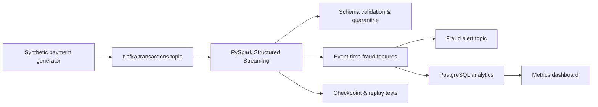

# StreamShield — Real-Time Fraud Detection & Streaming Analytics Platform

> **Status: Phase 1 implemented and locally benchmarked; Phase 2 Kafka/Docker successfully tested locally.** Phase 3 PySpark Structured Streaming verified locally; PostgreSQL, monitoring, and large-scale streaming benchmarks are planned. Synthetic data only. No real payment data or fraud decisions.

## Why this project

Demonstrate event-driven data engineering beyond traditional batch ETL: reproducible high-volume transaction generation, explainable risk signals, schema enforcement, quarantine, and replay-safe processing. Later phases will implement real Kafka ingestion, event-time Spark streaming, fault recovery, and analytics sinks.

## Target architecture



**Implemented in Phase 1:** `synthetic JSONL events → validate → explainable risk rules → transactionally deduplicated SQLite event/alert tables`. This is a local baseline, not a distributed streaming system.

## What is built

- **Deterministic synthetic generator:** generates events incrementally without keeping millions of records in memory; configurable count and seed; no personal data.
- **Versioned event schema:** stable `event_id`, transaction/account IDs, UTC event time, amount in integer cents, merchant category, and synthetic labels for demos.
- **Validation and quarantine:** malformed events are counted and recorded without storing raw payloads in the quarantine log.
- **Explainable risk signals:** high amount and synthetic-country anomaly. These are illustrative rules, *not calibrated fraud predictions*.
- **Replay-safe local sink:** SQLite primary-key deduplication ensures alert writes and event registration are atomic on successful transactions.
- **Unit tests and GitHub Actions workflow:** correctness, replay, malformed records, version checks.
- **Scale-ready generator API:** can request 1M or 5M synthetic records, subject to available disk/compute. These counts are **configurations, not completed benchmarks**.

## Quick start (Python 3.10+; no AWS, Kafka or Docker required for Phase 1)

```bash
python3 -m venv .venv
source .venv/bin/activate
python -m pip install -e .
python -m unittest discover -s tests -v

# Generate 10K synthetic events
streamshield generate --count 10000 --output outputs/events.jsonl
# Process events and persist local alerts
streamshield process --input outputs/events.jsonl --database outputs/fraud.db
# Replay: expect inserted=0 and duplicate=10000
streamshield process --input outputs/events.jsonl --database outputs/fraud.db

# Local performance measurement; use a new database for each independent trial
streamshield benchmark --count 100000 --output outputs/benchmark.jsonl --database outputs/benchmark.db
```

Output files are excluded from Git. Do **not** commit transaction events or DB dumps to a public repository, even if synthetic data is used in the demo.

## Measured Phase 1 benchmark (November 24, 2026)

A local benchmark processed **1,000,000 synthetic JSONL transactions** into the SQLite-backed replay-safe sink with **zero rejected rows**, **16,085 illustrative risk alerts**, and **zero duplicates on the first processing pass**. Measured processing time was **11.538 seconds** (~**86,670 events/second**) on the test container (**Linux x86_64, Python 3.13.5**). This measurement **does not include event generation**, Docker/Kafka/Spark, or network transport. Hardware resources were not profiled; results should not be generalized to different environments. Source: [`docs/MEASURED_PHASE1_RESULTS.json`](docs/MEASURED_PHASE1_RESULTS.json). The eight Phase 1 unit tests passed.

**Important:** This is a local batch-style file processing benchmark, **not** measured real-time streaming throughput or end-to-end fraud detection latency. The remaining platform stages are pending.

## Architecture decisions and limitations

- **Why integer cents?** Avoid floating-point rounding for payments.
- **Why separate event time?** Next phase needs watermarks and delayed-event handling.
- **Why event_id?** Duplicate deliveries are common in event-driven systems.
- **Why SQLite now?** Low-friction local replay correctness before adding distributed infrastructure; it is not a throughput or availability equivalent of Kafka/Spark/Postgres.
- **Exactly-once boundary:** SQLite prevents duplicate persisted effects by event ID within one database. This does not imply exactly-once events across Kafka, Spark, and external sinks.
- **Fraud accuracy:** Synthetic labels are for unit tests and sample data. No real-world precision, recall, or false-positive claims are made.
- **Performance:** Always distinguish file generation, local SQLite processing, and future Kafka/Spark streaming. The local benchmark excludes generation time.

## Phase 2: Kafka local demo

See [Kafka + Docker setup and verification](docs/PHASE2_KAFKA_LOCAL.md). This phase adds a single-node Kafka KRaft broker, six-partition transactions topic, an idempotent Python event producer and a local replay-safe consumer. Kafka runtime throughput has not yet been measured.

## Verified Phase 2 local Kafka results (November 24, 2026)

The local macOS Docker deployment was exercised with Apache Kafka 4.1.1. The user-observed run reported:

| Check | Observed result |
|---|---:|
| Kafka broker | Docker container healthy |
| Topics created | 3 |
| Transactions produced / acknowledged | 10,000 / 10,000 |
| Producer elapsed time | 1.287 s |
| Producer failed / unflushed | 0 / 0 |
| Durable SQLite transactions | 10,000 |
| Stored synthetic fraud-risk alerts | 161 |
| Fresh consumer group replay | 10,000 read, 10,000 duplicates, 0 inserted, 0 invalid, 0 new alerts |

**Interpretation:** This verifies the local Kafka producer/consumer path and replay-safe persisted effects in SQLite. The producer rate of about 7,770 acknowledged messages per second is **not** an end-to-end streaming throughput or latency benchmark. The original offset/consumer-run history was not comprehensively instrumented; the replay result was verified independently. Fraud-risk alerts come from illustrative rules over synthetic events. The reserved alert and DLQ Kafka topics are not yet populated by the consumer.

## Phase 3: Spark Structured Streaming

The new [Spark + Kafka setup guide](docs/PHASE3_SPARK.md) describes Spark 3.5.6, its matching Kafka connector, event-time deduplication and console window updates. Code is committed but **no Spark execution result has been verified yet**.

## Verified Phase 3 PySpark results (November 24, 2026)

The PySpark 3.5.6 Structured Streaming job completed on a local macOS environment using Java 17 and Kafka 4.1.1. The persisted Parquet output was independently queried with Spark SQL aggregation:

| Metric | Observed count |
|---|---:|
| Persisted transactions | **10,000** |
| Distinct `event_id` values | **10,000** |
| Synthetic fraud-risk flags | **161** |

The unique event count equals the persisted row count, showing no duplicate event IDs **in the verified output**. The 161 synthetic risk flags match the Phase 2 SQLite alert count. This verifies the Kafka → Spark → Parquet path for this dataset and configuration; it does not yet establish recovery correctness, late-data behavior under injected disorder, production fault tolerance, or distributed scale performance.

The local Spark run emitted informational/warning log messages about network binding and native Hadoop libraries; its final Parquet verification query succeeded.

## Roadmap for flagship portfolio completion

| Phase | Deliverable | Current state |
|---|---|---|
| 1 | Generator, schema, local risk rules, replay tests, CI | Implemented |
| 2 | Docker Compose Kafka KRaft, topic creation, producer, consumer | Verified locally |
| 3 | PySpark Structured Streaming, event-time windows, watermarks, deduplication | Verified locally |
| 4 | PostgreSQL analytical models, alert idempotency, SQL KPI queries | Planned |
| 5 | Late/out-of-order events, failure recovery, DLQ, checkpoint tests | Planned |
| 6 | Million-event load tests, throughput/p95 lag, resource profiling | Planned |
| 7 | Prometheus/Grafana metrics, runbook, screenshots, security hardening | Planned |

**Target stretch goal:** reproducibly ingest and process 5M+ synthetic transactions on appropriately provisioned hardware. No performance or scale result is claimed until actually measured.

## Safety and scope

Educational synthetic project, not a production fraud system. Do not expose Kafka or databases directly to the internet. Use credentials and encryption for real deployments; local examples are intended for development only.
