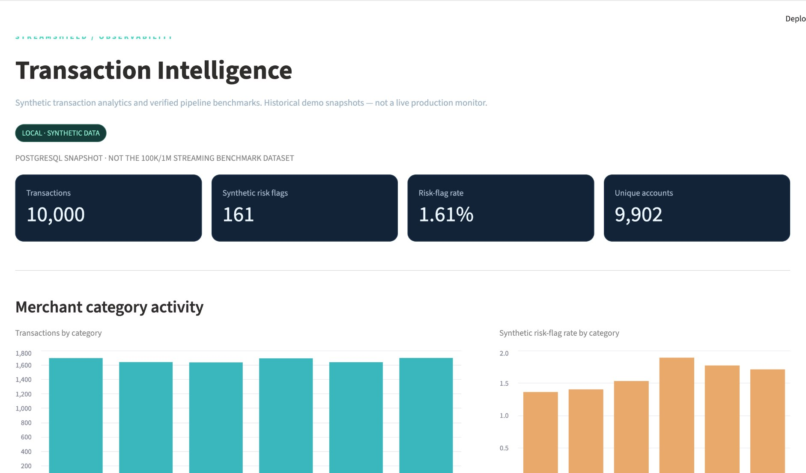
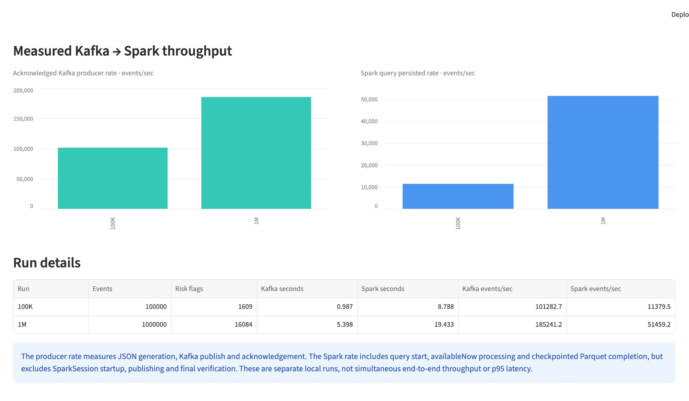
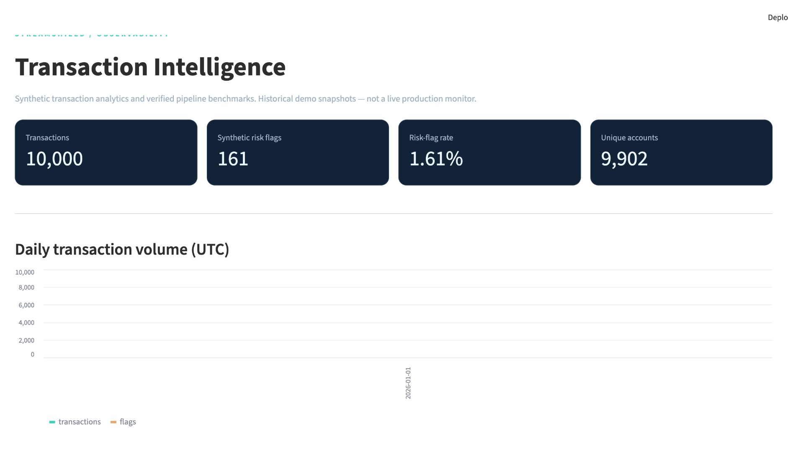
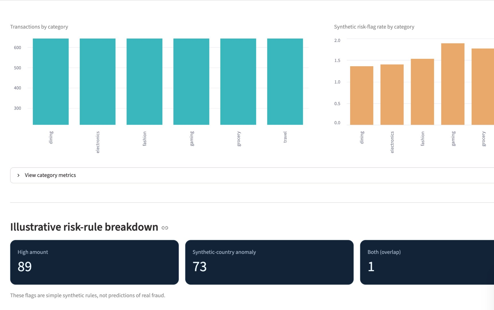
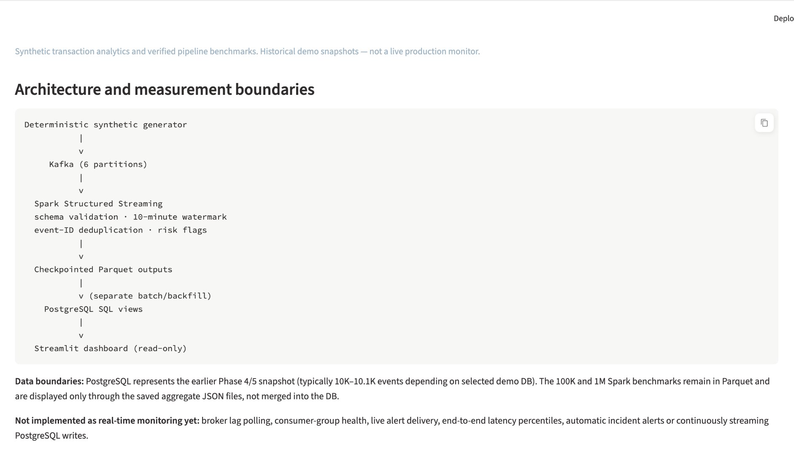
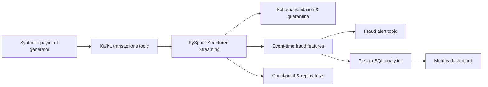

# 🛡️ StreamShield — Real-Time Fraud Detection & Streaming Analytics Platform

**Kafka · PySpark Structured Streaming · PostgreSQL · Parquet · Docker · Streamlit · Python**

A local end-to-end, **synthetic transaction streaming** portfolio project demonstrating Kafka ingestion, Spark event-time processing, data-quality quarantine, checkpoint recovery, replay-safe storage, SQL analytics and a browser-based dashboard. The saved benchmarks have been independently reconciled; this is a learning platform, **not a production fraud-classification system**.

### 📸 Dashboard preview



<sub>Read-only Streamlit dashboard showing the **historical PostgreSQL demo snapshot**. The 100K and 1M benchmark datasets are separate and are **not** loaded into this PostgreSQL snapshot.</sub>

### 🚀 Measured local streaming benchmarks

| Verified metric | 100K events | 1M events |
|---|---:|---:|
| Kafka producer acknowledgements | 100,000 | 1,000,000 |
| Producer publishing duration | 0.987 s | 5.398 s |
| Kafka acknowledged rate | **101,282.7 events/s** | **185,241.2 events/s** |
| Spark query + Parquet completion | 8.788 s | 19.433 s |
| Spark persisted rate | **11,379.5 events/s** | **51,459.2 events/s** |
| Synthetic risk flags | 1,609 | 16,084 |
| Unique IDs / reconciled Kafka offsets | All | All |
| Independent verification | **PASS** | **PASS** |

The producer and Spark timings are **separate, sequential local measurements**. Spark timing includes `availableNow` query startup, processing, checkpointing and Parquet writes, but excludes SparkSession startup and post-run verification. These figures are **not end-to-end throughput, sustained production rates, or p95 latency**. See [benchmark methodology](docs/PHASE6_BENCHMARK.md) and [1M verification](docs/PHASE6_1M_SCALE.md).



### 📊 Dashboard gallery

| Transaction activity | Risk analysis |
|---|---|
|  |  |

<sub>The daily chart is a **single synthetic event date**, not a multi-day production trend. Risk flags reflect illustrative high-amount and synthetic-country rules, not real-world fraud detection accuracy.</sub>

#### Pipeline architecture



**Architecture note:** Kafka → Spark → checkpointed Parquet is implemented; PostgreSQL analytics are populated using a **separate replay-safe batch/backfill loader**, not an always-on Spark-to-PostgreSQL sink. Invalid messages in the Phase 5D demonstration are held in **Parquet quarantine**, not published to a Kafka DLQ topic. See [Phase 7 dashboard documentation](docs/PHASE7_DASHBOARD.md).

### ▶️ Run the dashboard locally (macOS)

```bash
cd ~/Documents/streamshield-realtime-fraud-platform
source .venv-spark/bin/activate
python -m pip install -e '.[dashboard]'
docker compose up -d
streamlit run dashboard/app.py
```

Then visit **http://localhost:8501**. To stop the dashboard, use `Ctrl+C`; source data and checkpoints are preserved. See [full dashboard setup](docs/PHASE7_DASHBOARD.md). The dashboard reads saved benchmark JSON and existing PostgreSQL views; it does not launch streaming jobs or poll live broker lag.

### 🩺 Phase 9 — Optional Docker dashboard and local health checks

A new **System Health** page reports point-in-time Kafka/PostgreSQL TCP reachability and availability of the saved benchmark JSON reports. To build and run the dashboard in its own container, without restarting or deleting your existing data:

```bash
git pull
docker compose --profile dashboard up -d --build
# Open http://localhost:8501, then select System Health
```

The service mounts `outputs/` **read-only** and is intended for local development. These checks **do not** measure consumer lag, live fraud alerts, or end-to-end latency. **Phase 9 locally verified on November 25, 2026:** Docker dashboard built and opened in the browser; Kafka and PostgreSQL showed reachable TCP endpoints, three benchmark reports showed Present, and the user confirmed the updated tests passed. See [launch and test instructions](docs/PHASE9_LOCAL_MONITORING.md).

### 📡 Phase 10A — Kafka topic offset inspection (verification pending)

The Docker Streamlit dashboard now includes a **Kafka Topics** page showing existing `streamshield.*` topics, partitions, and earliest/latest retained offsets through a **read-only Kafka Admin API**. It does not join consumer groups, consume messages, or alter checkpoints. **Retained offset span is not consumer lag**, and it does not prove that Spark has caught up.

```bash
git pull
python -m unittest discover -s tests -v
docker compose --profile dashboard up -d --build
```

Open **http://localhost:8501 → Kafka Topics**. This phase is **not yet locally verified**. Details: [Phase 10A Kafka observability](docs/PHASE10_KAFKA_OBSERVABILITY.md).

### ✅ Reliability demonstrated

- **Event uniqueness:** 100K and 1M Kafka → Spark → Parquet outputs reconciled to unique event IDs and contiguous Kafka offsets on six partitions.
- **Checkpoint recovery:** abrupt local Spark-driver interruption followed by checkpoint-based recovery to 300 unique synthetic events.
- **Invalid event handling:** isolated two-accepted/four-quarantined test with one explicit rejection reason per invalid record; repeat run showed no duplicates.
- **Event-time behavior:** isolated watermark fixture verified on-time, allowed out-of-order, too-late, and duplicate-event cases.
- **PostgreSQL replay safety:** simulated post-commit failure recovered from 2K to 10K persisted transactions without duplicate rows.
- **Tests:** 37 unit tests passed locally when the Streamlit dashboard was verified on November 25, 2026.

This local demonstration does **not** establish production-grade exactly-once semantics across systems, live transaction risk scoring, multi-node failure tolerance, or automated alert delivery.

---

## Implementation notes and verification history

## Why this project

Demonstrate event-driven data engineering beyond traditional batch ETL: reproducible high-volume transaction generation, explainable risk signals, schema enforcement, quarantine, and replay-safe processing. Kafka ingestion, Spark streaming, and local PostgreSQL analytics are implemented and tested; upcoming work covers controlled failures, late data, and monitoring.

## Target architecture



**Implemented in Phase 1:** `synthetic JSONL events → validate → explainable risk rules → transactionally deduplicated SQLite event/alert tables`. This is a local baseline, not a distributed streaming system.

## What is built

- **Deterministic synthetic generator:** generates events incrementally without keeping millions of records in memory; configurable count and seed; no personal data.
- **Versioned event schema:** stable `event_id`, transaction/account IDs, UTC event time, amount in integer cents, merchant category, and synthetic labels for demos.
- **Validation and quarantine:** malformed events are counted and recorded without storing raw payloads in the quarantine log.
- **Explainable risk signals:** high amount and synthetic-country anomaly. These are illustrative rules, *not calibrated fraud predictions*.
- **Replay-safe local sink:** SQLite primary-key deduplication ensures alert writes and event registration are atomic on successful transactions.
- **Unit tests and GitHub Actions workflow:** correctness, replay, malformed records, version checks.
- **Scale-ready generator API:** can request 1M or 5M synthetic records, subject to available disk/compute. These counts are **configurations, not completed benchmarks**.

## Quick start (Python 3.10+; no AWS, Kafka or Docker required for Phase 1)

```bash
python3 -m venv .venv
source .venv/bin/activate
python -m pip install -e .
python -m unittest discover -s tests -v

# Generate 10K synthetic events
streamshield generate --count 10000 --output outputs/events.jsonl
# Process events and persist local alerts
streamshield process --input outputs/events.jsonl --database outputs/fraud.db
# Replay: expect inserted=0 and duplicate=10000
streamshield process --input outputs/events.jsonl --database outputs/fraud.db

# Local performance measurement; use a new database for each independent trial
streamshield benchmark --count 100000 --output outputs/benchmark.jsonl --database outputs/benchmark.db
```

Output files are excluded from Git. Do **not** commit transaction events or DB dumps to a public repository, even if synthetic data is used in the demo.

## Measured Phase 1 benchmark (November 24, 2026)

A local benchmark processed **1,000,000 synthetic JSONL transactions** into the SQLite-backed replay-safe sink with **zero rejected rows**, **16,085 illustrative risk alerts**, and **zero duplicates on the first processing pass**. Measured processing time was **11.538 seconds** (~**86,670 events/second**) on the test container (**Linux x86_64, Python 3.13.5**). This measurement **does not include event generation**, Docker/Kafka/Spark, or network transport. Hardware resources were not profiled; results should not be generalized to different environments. Source: [`docs/MEASURED_PHASE1_RESULTS.json`](docs/MEASURED_PHASE1_RESULTS.json). The eight Phase 1 unit tests passed.

**Important:** This is a local batch-style file processing benchmark, **not** measured real-time streaming throughput or end-to-end fraud detection latency. The remaining platform stages are pending.

## Architecture decisions and limitations

- **Why integer cents?** Avoid floating-point rounding for payments.
- **Why separate event time?** Next phase needs watermarks and delayed-event handling.
- **Why event_id?** Duplicate deliveries are common in event-driven systems.
- **Why SQLite now?** Low-friction local replay correctness before adding distributed infrastructure; it is not a throughput or availability equivalent of Kafka/Spark/Postgres.
- **Exactly-once boundary:** SQLite prevents duplicate persisted effects by event ID within one database. This does not imply exactly-once events across Kafka, Spark, and external sinks.
- **Fraud accuracy:** Synthetic labels are for unit tests and sample data. No real-world precision, recall, or false-positive claims are made.
- **Performance:** Always distinguish file generation, local SQLite processing, and future Kafka/Spark streaming. The local benchmark excludes generation time.

## Phase 2: Kafka local demo

See [Kafka + Docker setup and verification](docs/PHASE2_KAFKA_LOCAL.md). This phase adds a single-node Kafka KRaft broker, six-partition transactions topic, an idempotent Python event producer and a local replay-safe consumer. Kafka runtime throughput has not yet been measured.

## Verified Phase 2 local Kafka results (November 24, 2026)

The local macOS Docker deployment was exercised with Apache Kafka 4.1.1. The user-observed run reported:

| Check | Observed result |
|---|---:|
| Kafka broker | Docker container healthy |
| Topics created | 3 |
| Transactions produced / acknowledged | 10,000 / 10,000 |
| Producer elapsed time | 1.287 s |
| Producer failed / unflushed | 0 / 0 |
| Durable SQLite transactions | 10,000 |
| Stored synthetic fraud-risk alerts | 161 |
| Fresh consumer group replay | 10,000 read, 10,000 duplicates, 0 inserted, 0 invalid, 0 new alerts |

**Interpretation:** This verifies the local Kafka producer/consumer path and replay-safe persisted effects in SQLite. The producer rate of about 7,770 acknowledged messages per second is **not** an end-to-end streaming throughput or latency benchmark. The original offset/consumer-run history was not comprehensively instrumented; the replay result was verified independently. Fraud-risk alerts come from illustrative rules over synthetic events. The reserved alert and DLQ Kafka topics are not yet populated by the consumer.

## Phase 3: Spark Structured Streaming

The [Spark + Kafka setup guide](docs/PHASE3_SPARK.md) describes Spark 3.5.6, its matching Kafka connector, event-time deduplication and console window updates. **The local streaming run has been verified**, as documented below.

## Verified Phase 3 PySpark results (November 24, 2026)

The PySpark 3.5.6 Structured Streaming job completed on a local macOS environment using Java 17 and Kafka 4.1.1. The persisted Parquet output was independently queried with Spark SQL aggregation:

| Metric | Observed count |
|---|---:|
| Persisted transactions | **10,000** |
| Distinct `event_id` values | **10,000** |
| Synthetic fraud-risk flags | **161** |

The unique event count equals the persisted row count, showing no duplicate event IDs **in the verified output**. The 161 synthetic risk flags match the Phase 2 SQLite alert count. This verifies the Kafka → Spark → Parquet path for this dataset and configuration; it does not yet establish recovery correctness, late-data behavior under injected disorder, production fault tolerance, or distributed scale performance.

The local Spark run emitted informational/warning log messages about network binding and native Hadoop libraries; its final Parquet verification query succeeded.

## Phase 4: PostgreSQL analytics

Phase 4 adds a local [PostgreSQL analytics setup guide](docs/PHASE4_POSTGRES.md), a Docker PostgreSQL service, an idempotent loader from Spark Parquet, transaction constraints/indexes, and daily/category KPI views. The local load, replay and SQL views have been verified; this is a batch/backfill sink, not continuous Spark-to-PostgreSQL streaming.

## Verified Phase 4 PostgreSQL ingestion and replay (November 25, 2026)

A local macOS run loaded the previously verified Spark Parquet output into PostgreSQL 16, then reran the **identical load** to test duplicate prevention.

| Metric | First load | Identical replay |
|---|---:|---:|
| Source records | 10,000 | 10,000 |
| Distinct input event IDs | 10,000 | 10,000 |
| Input synthetic risk flags | 161 | 161 |
| Newly inserted | **10,000** | **0** |
| Total PostgreSQL transactions | **10,000** | **10,000** |
| Total PostgreSQL flagged transactions | **161** | **161** |
| UTC daily KPI rows | 1 | 1 |

This validates a **local replay-safe Parquet-to-PostgreSQL batch/backfill load** using `ON CONFLICT (event_id) DO NOTHING`. It does not yet verify continuous streaming writes, recovery from injected database failure, or payload-conflict detection. SQL view output still awaits explicit local inspection.

**UTC date regression resolved (November 25):** The first load had grouped records under `2025-12-31` because a local-time Python timestamp was incorrectly treated as UTC. The loader now reconstructs timestamps using Spark epoch microseconds. The user confirmed that the regression tests and clean-database verification passed; expected synthetic event date is `2026-01-01` UTC. See [Phase 4 UTC verification steps](docs/PHASE4_POSTGRES.md).

**Phase 4 SQL analytics:** The local PostgreSQL `daily_kpis` and `merchant_category_kpis` views were exercised: 10,000 transactions, 161 synthetic risk flags (1.61%), 291,841,656 cents total, and six reconciled merchant categories. The initial timezone grouping issue was subsequently corrected and verified against a new demo database.

## Phase 5: Controlled failure and recovery

[Phase 5 recovery test instructions](docs/PHASE5_RECOVERY.md) use a **separate PostgreSQL database**. The loader can deliberately throw a `SIMULATED_FAILURE_AFTER_COMMIT` exception after a configured number of successful transaction batches. Replaying the source should insert only missing events and preserve one row per event ID. Code and unit tests are committed; **the crash/recovery scenario has not yet been run locally**, and the Kafka/Spark failure, watermark/late-data and DLQ tests remain outstanding.

## Verified Phase 5 PostgreSQL crash/recovery test (November 25, 2026)

A local macOS test injected an intentional failure **after two committed batches of 1,000 rows** in an isolated PostgreSQL database (`streamshield_recovery_v1`).

| Measurement | Observed |
|---|---:|
| Persisted before simulated failure | 2,000 transactions |
| Synthetic risk flags before failure | 29 |
| Newly inserted on recovery | 8,000 |
| Total persisted after recovery | 10,000 |
| Total risk flags after recovery | 161 |
| Distinct source event IDs | 10,000 |

The loader raised the expected `SIMULATED_FAILURE_AFTER_COMMIT` error; rerunning it without injection restored the full dataset. This verifies a **manual retry of an idempotent PostgreSQL batch/backfill sink** after a post-commit failure; it does not yet demonstrate Kafka broker failure, Spark checkpoint recovery, late-arriving events, automatic restart, or end-to-end exactly-once delivery. The user reported that the additional identical replay passed, completing the PostgreSQL idempotent recovery check.

## Phase 5B: Spark checkpoint restart verification

A [non-destructive Spark checkpoint restart test](docs/PHASE5_SPARK_CHECKPOINT.md) has been added, including a read-only verifier and unit tests. It checks the existing 10,000-event baseline, graceful Spark restart with the same checkpoints, ingestion of 100 new Kafka events, then repeated restart without duplicate persisted output. **This portion is coded but has not yet been run locally.** It does not test a forced process crash or distributed fault recovery.

## Verified Phase 5 Spark checkpoint incremental restart (November 25, 2026)

The local macOS Spark 3.5.6 streaming job restarted with the **existing** `outputs/spark_phase3` checkpoint and retained its previously verified 10,000 persisted events. An initial attempt to publish 100 more records had not reached Kafka because the active Python virtual environment lacked the `confluent-kafka` dependency; installing the Kafka extra resolved that prerequisite. The producer subsequently acknowledged 100 of 100 new events (0 failures; 0 unflushed), and Spark was run again using the same checkpoint.

| Read-only Parquet verification metric | Baseline | After incremental resume |
|---|---:|---:|
| Persisted events | 10,000 | **10,100** |
| Distinct event IDs | 10,000 | **10,100** |
| Synthetic risk flags | 161 | **163** |
| New event IDs verified (10000–10099) | — | **100** |
| Verifier status | PASS | **PASS** |

This confirms a **graceful checkpoint-based restart followed by incremental processing without duplicate persisted event IDs** for this local test. A final no-new-message restart was also run and the read-only verifier reported **PASS**, unchanged at **10,100 rows, 10,100 unique IDs, 163 synthetic risk flags**, with the 100 new IDs verified. Forced interruption during a micro-batch remains untested; these results do not prove end-to-end exactly-once semantics or fault tolerance under forced process termination.

## Phase 5C: Isolated late and out-of-order event test

The [Phase 5C watermark experiment](docs/PHASE5_WATERMARK.md) was **verified locally on November 25, 2026**. It uses a separate one-partition Kafka topic, isolated Parquet sink and Spark checkpoint, and a two-stage fixture with a late event, a within-watermark out-of-order event, an on-time event, and a duplicate ID. The read-only verifier checks actual persisted IDs. The read-only follow-up verifier reported **PASS**, 4 persisted rows, 4 distinct event IDs, and `late_event_absent=true`, with IDs `wm_on_time`, `wm_outorder`, `wm_seed_1`, `wm_seed_2`. Thus the deliberately very late event was excluded, the within-watermark out-of-order event was retained, and a repeated seed ID had no duplicate persisted effect. This is one controlled watermark experiment, not comprehensive validation under all arrival schedules.

## Phase 5D: Isolated malformed-event quarantine test (awaiting local verification)

The [Phase 5D DLQ/quarantine guide](docs/PHASE5_DLQ.md) describes an isolated six-message Kafka fixture and separate Spark Parquet sinks: 2 valid transactions and 4 deliberately invalid records. The rejected sink stores the Kafka topic/partition/offset, optional event ID, and rejection reason **without retaining raw payloads**. A read-only verifier checks all six Kafka offsets are accounted for and that no invalid records enter the accepted output. The user verified the isolated Spark routing and independent verifier on November 25, 2026: **PASS**, 6 Kafka offsets reconciled, 2 accepted, 4 rejected, and one rejection each for invalid amount, missing account ID, invalid timestamp and malformed/missing event ID. The user subsequently restarted the identical Spark DLQ job using the same checkpoints, and the independent verifier again returned **PASS** with unchanged totals (2 accepted, 4 rejected, all 6 source offsets reconciled), demonstrating no duplicate persisted effects in this controlled replay. This is a local Parquet quarantine/DLQ equivalent; the dedicated Kafka DLQ topic is not published to.

## Phase 5E: Isolated forced Spark driver crash (local validation pending)

The [Phase 5E forced-crash runbook](docs/PHASE5_SPARK_FORCED_CRASH.md) now provides a guarded single-topic, 300-synthetic-event test. An isolated Spark driver processes Kafka in 50-record micro-batches using a dedicated Parquet sink and checkpoint, then deliberately calls `SIGKILL` on itself after observing completed micro-batches. Independent read-only verification checks partial persisted results and full recovery after restart with the same checkpoint. **Local partial-state and full checkpoint recovery verification passed on November 25, 2026**: after the deliberately interrupted driver run, the independent verifier found 100 persisted transactions with 100 unique event IDs and 100 unique Kafka offsets; after the recovery run it reported PASS with all 300 events, 300 unique IDs and all 300 offsets accounted for. The user subsequently reported completing the final no-new-message recovery rerun; the final verifier output was not pasted, so the unchanged counts for that replay have not been independently inspected. This is driver SIGKILL recovery for a local Parquet sink; it does not prove JVM/broker failover or mid-transaction external-sink recovery.

## Phase 6: Performance measurement (not yet benchmarked on Mac)

The [Phase 6 measurement guide](docs/PHASE6_BENCHMARK.md) starts with a **fresh 100,000-event local JSONL-to-SQLite baseline** to establish machine-specific processing throughput and data correctness. Planned subsequent runs will benchmark Kafka-to-Spark separately, with fresh topics/checkpoints and explicit scope. No macOS Phase 6 results have been measured yet; local file/SQLite throughput must not be represented as Kafka/Spark throughput or p95 event latency.

## Verified Phase 6 local macOS 100K baseline (November 25, 2026)

**Machine/environment:** macOS 26.6.2 (build 25G83), arm64, Python 3.11.9. Local synthetic JSONL → SQLite processing only; **not** Kafka, Spark, streaming latency or end-to-end throughput.

| Measurement | Fresh database | Existing database replay |
|---|---:|---:|
| Generated transactions | 100,000 | 100,000 |
| Generation duration | 0.435 s | 0.432 s |
| Processing duration | **0.501 s** | **0.474 s** |
| Processing rate | **199,494.0 events/s** | **211,121.9 events/s** |
| Newly inserted | 100,000 | 0 |
| Duplicate records | 0 | 100,000 |
| Rejected records | 0 | 0 |
| Newly written synthetic risk alerts | 1,608 | 0 |

The first observed replay run used an existing database and therefore exercised duplicate rejection. The subsequent **fresh** trial used `outputs/phase6_fresh_100k_trial2.db` and inserted all 100,000 events, creating 1,608 synthetic risk alerts. These are single-run measurements, not repeat-trial percentiles or performance guarantees. Streaming-stage benchmarking remains pending.

## Phase 6B: Kafka -> Spark 100K benchmark (local execution pending)

The [Phase 6 guide](docs/PHASE6_BENCHMARK.md) now documents an isolated 100,000-event Kafka producer and checkpointed Spark 3.5.6 Parquet benchmark. The source topic `streamshield.benchmark_100k.v1` has six partitions; the Spark pipeline reuses transaction validation, watermark/event-ID deduplication and illustrative risk flags from the primary job. It writes only to `outputs/spark_benchmark_100k`. A read-only verifier reconciles all 100,000 synthetic event IDs and all six partitions' Kafka offset ranges. Producer acknowledgement and Spark query timing are reported separately. **Code and tests have been committed, but Kafka → Spark data reconciliation verified; processing timing output still pending.**

## Roadmap for flagship portfolio completion

| Phase | Deliverable | Current state |
|---|---|---|
| 1 | Generator, schema, local risk rules, replay tests, CI | Implemented |
| 2 | Docker Compose Kafka KRaft, topic creation, producer, consumer | Verified locally |
| 3 | PySpark Structured Streaming, event-time windows, watermarks, deduplication | Verified locally |
| 4 | PostgreSQL analytical models, alert idempotency, SQL KPI queries | Verified locally |
| 5 | Late/out-of-order events, failure recovery, DLQ, checkpoint tests | PostgreSQL recovery and Spark checkpoint restart verified; watermark verified; isolated Parquet quarantine and replay verified; forced Spark driver crash and checkpoint recovery verified; final no-op replay and Kafka DLQ publication pending |
| 6 | Million-event load tests, throughput/p95 lag, resource profiling | 100K macOS local SQLite fresh-ingestion and replay measured; Kafka/Spark throughput pending |
| 7 | Prometheus/Grafana metrics, runbook, screenshots, security hardening | Planned |

**Target stretch goal:** reproducibly ingest and process 5M+ synthetic transactions on appropriately provisioned hardware. No performance or scale result is claimed until actually measured.

## Safety and scope

Educational synthetic project, not a production fraud system. Do not expose Kafka or databases directly to the internet. Use credentials and encryption for real deployments; local examples are intended for development only.

## Verified Phase 6B Kafka → Spark 100K reconciliation (November 25, 2026)

The independent read-only `stream_bench_verify` on the user's Apple Silicon Mac returned **PASS**: 100,000 persisted events; 100,000 unique event IDs; 0 invalid IDs; 100,000 reconciled Kafka offsets; no verifier errors. The six source partitions had counts **16,807 / 16,601 / 16,530 / 17,172 / 16,509 / 16,381**, each with contiguous offsets from 0 through `rows - 1` and no duplicate coordinates.

**Performance measurement pending:** The user has not supplied the separate Spark benchmark JSON containing `spark_query_elapsed_seconds` and `persisted_events_per_query_second`. Do not infer Kafka/Spark throughput or event latency from the read-only reconciliation results.


## Phase 6C: Saved-timing streaming benchmark (v2, local run pending)

After the 100K v1 Kafka/Spark Parquet benchmark passed independent ID/offset reconciliation, its original query elapsed time was unavailable. The v1 benchmark intentionally refuses a subsequent attempt to overwrite the existing Parquet output. A distinct [v2 benchmark trial](docs/PHASE6_BENCHMARK.md) is now implemented against `streamshield.benchmark_100k.v2` and `outputs/spark_benchmark_100k_v2`, with **automatic JSON persistence** of query duration and throughput at `outputs/spark_benchmark_100k_v2/benchmark_result.json`. The v2 local trial passed and its measurements are recorded below.


**Verified v2 Kafka producer result (November 25, 2026):** Topic `streamshield.benchmark_100k.v2`; 6 partitions; 100,000 attempted/acknowledged, 0 failed, 0 unflushed; measured producer duration **0.987 seconds** and acknowledged rate **101,282.7 events/sec**. This is publisher-side timing and does not measure Spark processing or end-to-end latency. The v2 Spark trial and independent reconciliation passed; see the verified timing section.


**Verified v2 Spark data reconciliation (November 25, 2026):** Read-only verifier returned `PASS`, `total_events=100000`, `unique_event_ids=100000`, `invalid_event_ids=0`, and `reconciled_kafka_offsets=100000` with no errors. All six Kafka partitions had contiguous offset ranges and per-partition counts 16,807 / 16,601 / 16,530 / 17,172 / 16,509 / 16,381. The saved v2 Spark processing-time JSON has now been supplied and its values appear in the verified timing section below.


## Verified Phase 6C v2 100K streaming benchmark timing (November 25, 2026)

On macOS 26.6.2, Apple Silicon arm64, Python 3.11.9, the user captured the saved `outputs/spark_benchmark_100k_v2/benchmark_result.json`:

| Measurement | Result |
|---|---:|
| Source Kafka topic | `streamshield.benchmark_100k.v2` |
| Source/accepted events | 100,000 / 100,000 |
| Distinct accepted event IDs | 100,000 |
| Kafka offsets reconciled by independent verifier | 100,000 (six partitions) |
| Synthetic illustrative risk flags | 1,609 |
| Kafka producer acknowledgements | 100,000 (0 failed, 0 unflushed) |
| Kafka producer elapsed | **0.987 s** |
| Kafka acknowledged producer rate | **101,282.7 events/s** |
| Spark availableNow query elapsed | **8.788 s** |
| Spark persisted rows/query second | **11,379.5 events/s** |
| Independent reconciliation | **PASS** |

Spark query timing includes the call to start the query, `availableNow` processing and checkpointed Parquet sink completion. It excludes Kafka producer time, SparkSession initialization, and post-run verification. Kafka producer and Spark were benchmarked sequentially as distinct stages; do not treat the rate comparison as an end-to-end simultaneous pipeline throughput measurement or p95 latency. This is a single local test; stability and larger-scale performance remain to be measured.


## Phase 6D: 1M-event isolated streaming scale test (local run pending)

The [1M Kafka → Spark benchmark runbook](docs/PHASE6_1M_SCALE.md) adds a guarded one-time synthetic fixture (six Kafka partitions, `streamshield.benchmark_1m.v1`) and the existing Spark enrichment pipeline writing to `outputs/spark_benchmark_1m_v1`. The job automatically saves producer and Spark query duration/throughput JSON reports, with an independent Kafka-offset and event-ID verifier. The producer has a minimum 5 GiB *host* free-space preflight; Docker VM storage and memory also need checking. **No 1M run or performance measurements have been verified yet.** The completed 100K trial remains untouched.


**Observed 1M Kafka producer result (November 25, 2026):** Topic `streamshield.benchmark_1m.v1`, 6 partitions; attempted **1,000,000**, acknowledged **1,000,000**, failed **0**, unflushed **0**; elapsed **5.398 s**, acknowledged producer throughput **185,241.2 events/sec**; host free space before publishing **26.53 GiB**. The producer saved a local `outputs/spark_benchmark_1m_v1/producer_result.json` file. Spark Parquet reconciliation passed; measured Spark query duration and throughput remain pending review of the saved JSON. Producer throughput is a separate stage measurement, not end-to-end streaming throughput.


**Verified 1M Spark/Parquet reconciliation (November 25, 2026):** Local read-only verifier returned `PASS` with **1,000,000 persisted events**, **1,000,000 distinct event IDs**, **0 invalid IDs**, **1,000,000 reconciled Kafka offsets**, and `errors=[]`. Partition row counts (0–5): **168,159 / 165,140 / 165,021 / 171,692 / 166,078 / 163,910**; each partition's offset range started at 0 and ended at rows−1, with all offsets unique. The Spark processing report `benchmark_result.json` has now been shared and verified; see the 1M benchmark result table below. This is isolated local correctness verification, not proof of end-to-end exactly-once semantics.


## Verified Phase 6D 1M streaming benchmark results (November 25, 2026)

The locally saved `outputs/spark_benchmark_1m_v1/benchmark_result.json` was inspected after the independent read-only Kafka offset and event-ID reconciliation returned **PASS**.

| Metric | 100K v2 measured | 1M v1 measured |
|---|---:|---:|
| Events published / persisted | 100,000 / 100,000 | 1,000,000 / 1,000,000 |
| Kafka producer elapsed | 0.987 s | **5.398 s** |
| Acknowledged producer rate | 101,282.7 events/s | **185,241.2 events/s** |
| Spark availableNow query elapsed | 8.788 s | **19.433 s** |
| Spark persisted events/query second | 11,379.5 | **51,459.2** |
| Synthetic illustrative risk flags | 1,609 | **16,084** |
| Unique persisted event IDs | 100,000 | **1,000,000** |
| Reconciled Kafka offsets | 100,000 | **1,000,000** |
| Independent integrity check | PASS | **PASS** |

Spark rate was **4.52×** higher in the 1M run, but these are two single runs at different workload sizes and not repeated steady-state throughput experiments. The Spark timing includes query start, `availableNow` processing, checkpointed Parquet completion; it excludes Kafka publishing, SparkSession startup and post-run verification. Producer and Spark figures represent separate measurement scopes, not end-to-end latency or a single concurrent throughput rate. These checks demonstrate local result completeness/uniqueness for this synthetic fixture; they do not imply exactly-once across external sinks.


## Phase 7: Read-only Streamlit monitoring dashboard (local UI verification pending)

The [Phase 7 local dashboard guide](docs/PHASE7_DASHBOARD.md) describes a browser application implemented in `dashboard/app.py` with Overview, Transactions & Risk, Performance, and Pipeline Architecture pages. Install using `python -m pip install -e '.[dashboard]'` and launch with `streamlit run dashboard/app.py`. It reads the existing UTC-corrected PostgreSQL **historical snapshot** through read-only SQL and separately loads saved 100K and 1M benchmark JSON reports; it does **not** mix million-event benchmarks into PostgreSQL, start a Spark/Kafka job, or represent a continuously updating production monitor. The user verified on November 25, 2026 that the browser dashboard opened and all charts and metrics displayed correctly. All 37 locally run unit tests passed; Kafka and PostgreSQL containers were running.

