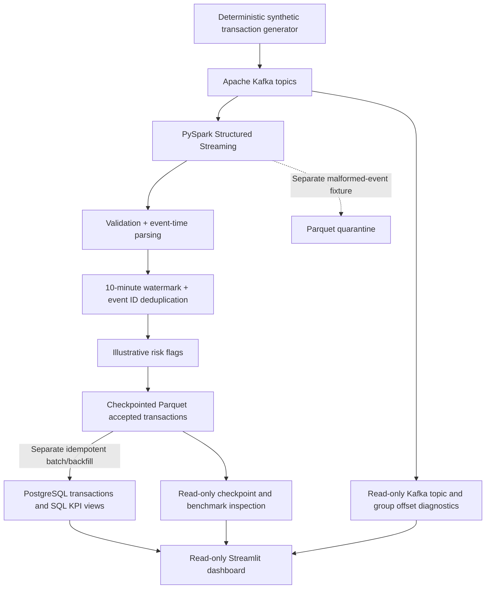

# StreamShield — Architecture and Engineering Decisions

## What actually runs

StreamShield is a **local educational data engineering platform** using deterministic **synthetic** payment events. It is not a trained fraud classifier, a live banking service, or a production distributed deployment.



This is a **logical overview of separately exercised paths**. PostgreSQL does not receive a continuously running Spark sink; the batch/backfill loader reads saved Parquet. The Kafka topic inspection and group lag are read-only snapshots. Spark offset checkpoints are independent of Kafka consumer-group commits. The quarantined malformed messages are persisted to Parquet in a separate Phase 5 fixture, **not** automatically published to a Kafka DLQ. The risk output is an illustrative boolean rule flag, not a fraud probability or a Kafka fraud-alert topic.

## Key decisions and trade-offs

| Decision | Why | Boundary |
|---|---|---|
| Kafka six-partition event streams | Practice partitioned ingestion and broker-offset reconciliation | Local single-node Kafka broker; no HA claim |
| Spark Structured Streaming | Event-time processing, watermarking, bounded deduplication | Saved availableNow micro-batches, not a continuously active production stream |
| Stable synthetic event IDs | Enable replay and uniqueness checks | Uniqueness demonstrated in saved outputs, not cross-system exactly-once |
| Parquet + Spark checkpoints | Durable replayable results and recovery experiments | Checkpoint metadata does not prove current driver health |
| PostgreSQL with conflict-safe inserts | Explore relational KPI views and idempotent backfills | Separate batch load, not live Spark-to-Postgres ingestion |
| Saved JSON reports + Streamlit | Reproducible demonstration of observed results | Historical data, manual refresh, no remote monitoring |
| Local TCP and file-presence alerts | Safe low-cost checks without modifying data | TCP is not application readiness or an end-to-end SLA |

## Evidence, not extrapolation

The verified 100K and 1M trials separately measured Kafka producer acknowledgements and Spark query-to-checkpointed-Parquet completion. The 1M run acknowledged and persisted 1,000,000 unique synthetic events and reconciled six partitions. Its Kafka producer took 5.398 s (~185,241 acknowledged/s), while its Spark query took 19.433 s (~51,459 persisted/query-second). **These are separate stages, not end-to-end throughput or transaction latency**. See [benchmark methodology](PHASE6_BENCHMARK.md) and [1M results](PHASE6_1M_SCALE.md).

The separate 3K Phase 11 fixture completed with 8 recorded Spark micro-batches, a maximum reported trigger execution of 3,162 ms, and 3,000 persisted distinct events. This is Spark's batch execution measurement, **not** p95 transaction latency. See [Phase 11](PHASE11_MICROBATCH_MONITORING.md).

The local monitoring view reports Kafka topic retained offset spans; Kafka consumer-group commits where available; saved Spark checkpoint batch IDs; and local TCP/report presence checks. No continuous live fraud-alert stream, automatic service repair, production pager/email delivery, ML fraud performance evaluation, or cluster-scale SLO is implemented.

## Failure and correctness exercises

- Replayed the same PostgreSQL source without creating duplicate `event_id` rows.
- Recovered a separately checkpointed Spark run after a forced driver interruption, preserving observed unique rows.
- Verified watermark/late-event and duplicate handling on isolated synthetic fixtures.
- Quarantined malformed event records to Parquet in a separate test.
- Reconciled 100K and 1M persisted event IDs and Kafka partition offsets independently.

These are **scoped local demonstrations**, not a universal exactly-once or production reliability guarantee.

## Safe reproduction

For an existing development machine with saved datasets, do **not** rerun the one-shot 100K, 1M, or 3K producers. Their safety guards reject existing input/output; never delete old checkpoints or topics to bypass them.

```bash
cd ~/Documents/streamshield-realtime-fraud-platform
source .venv-spark/bin/activate
python -m unittest discover -s tests -v
docker compose --profile dashboard up -d --build
```

Open `http://localhost:8501`, then stop **only** the optional dashboard with:

```bash
docker compose --profile dashboard stop dashboard
```

For a new environment, start with [Phase 2 Kafka](PHASE2_KAFKA_LOCAL.md), [Phase 3 Spark](PHASE3_SPARK.md) and [Phase 4 PostgreSQL](PHASE4_POSTGRES.md), following the individual preflight checks.

## Interview talking points

**Architecture:** “I built a local Kafka-to-Spark event-processing pipeline on synthetic payments, then stored checkpointed Parquet outputs and loaded a separate PostgreSQL analytics snapshot through replay-safe batch inserts.”

**Why this design:** “I used Kafka for partitioned source ingestion, Spark for event-time validation and deduplication, checkpoints for restart experiments, Parquet as the intermediate durable output, and PostgreSQL for reporting-friendly SQL views.”

**Failure handling:** “I tested replay after PostgreSQL commits, Spark driver interruption, malformed records, and late/out-of-order events. I validated expected persisted IDs and offsets instead of claiming a generic exactly-once guarantee.”

**Performance:** “I measured Kafka publishing and Spark Parquet processing separately, reconciled the data, and instrumented another isolated fixture for real per-microbatch Spark metrics. I did not treat stage rates as end-to-end latency.”

**Next production steps:** “For production I would introduce authenticated Kafka connections, service-level monitoring and alerts, stronger schema governance, controlled deployment, automated recovery, a true streaming analytics sink, and fraud model evaluation against real labeled data.”
